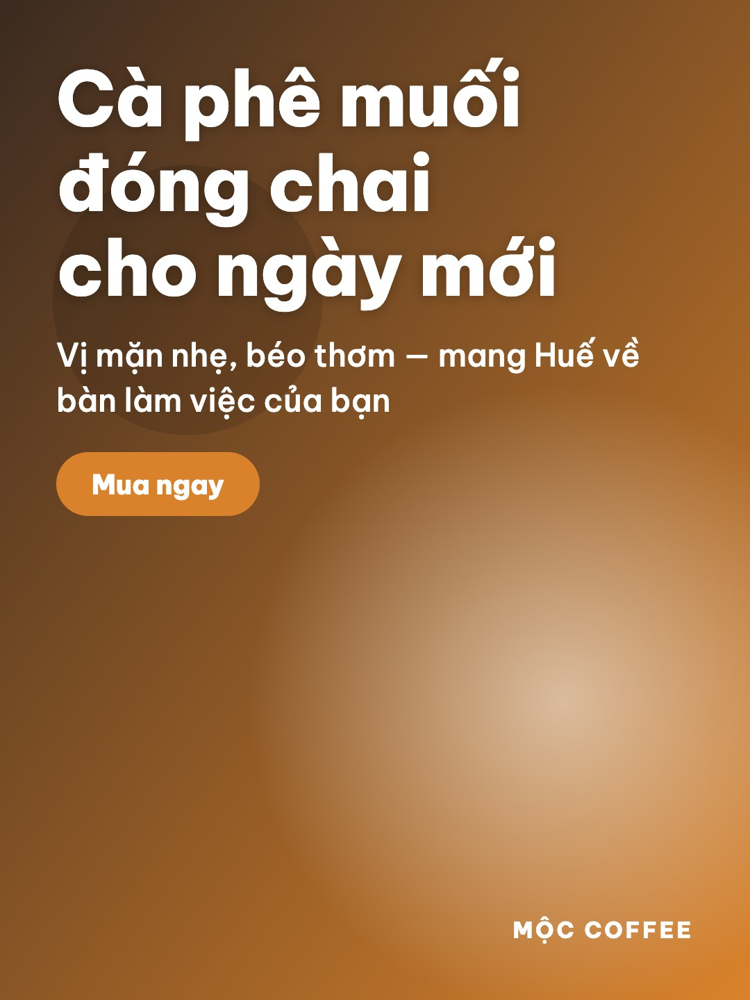
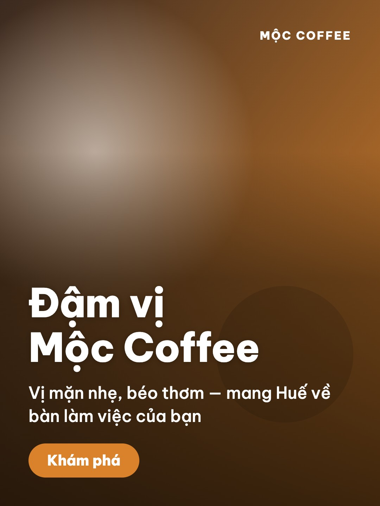
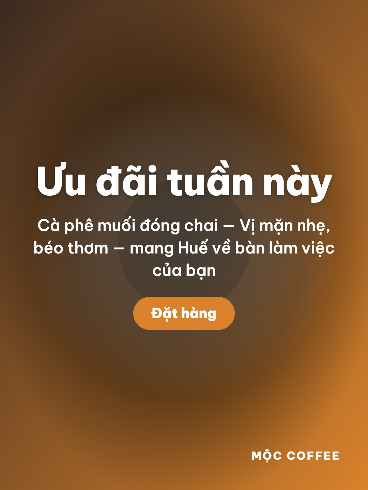
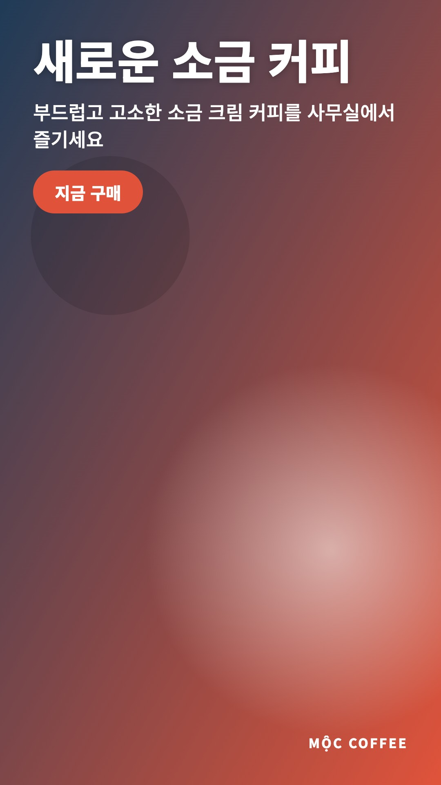

# AI Poster Studio

Tạo poster marketing cho mạng xã hội bằng AI: nhập thông tin thương hiệu → AI đề xuất **3 phương án** kèm lý do và bản xem trước → người dùng chọn **Áp dụng / Bỏ qua / Sửa chữ**.

Hỗ trợ **tiếng Việt, tiếng Hàn, tiếng Anh** và 3 tỉ lệ 1:1, 3:4, 9:16. Dự án được xây dựng bằng **Claude Code**.

| 3:4 · bố cục trên | 3:4 · bố cục dưới | 3:4 · bố cục giữa | 9:16 · tiếng Hàn |
|---|---|---|---|
|  |  |  |  |

*(Ảnh trên được tạo ở chế độ demo, với nền gradient theo màu thương hiệu. Khi có `GEMINI_API_KEY`, nền là ảnh do Gemini tạo.)*

## Luồng xử lý

```
Brief thương hiệu
  → [LLM, structured output] 3 phương án: headline, subline, CTA, bố cục, prompt ảnh, lý do
  → [validate bằng zod] sửa bố cục trùng, giới hạn độ dài
  → [Gemini image] ảnh nền KHÔNG có chữ, chừa khoảng trống đúng vùng đặt chữ
  → [Chromium headless] ghép chữ: tự thu nhỏ cỡ chữ cho vừa khung, ngắt dòng theo ngôn ngữ
  → [Kiểm tra chất lượng] đo tương phản WCAG ngay dưới vùng chữ, kiểm tra tràn chữ, cỡ chữ, độ dài
  → [Tự sửa theo luật] tương phản thấp → thêm lớp phủ (scrim) rồi đo lại
  → UI: đề xuất kèm lý do + huy hiệu chất lượng → người dùng quyết định
```

## Các quyết định thiết kế

- **AI chỉ tạo ảnh nền, chữ ghép bằng code.** Model tạo ảnh hay viết sai hoặc méo chữ, nhất là tiếng Việt có dấu và tiếng Hàn. Ghép chữ bằng Chromium cho chữ luôn đúng, đúng font, và sửa chữ được mà không phải sinh lại ảnh.
- **Không tin hoàn toàn vào prompt do LLM viết.** Server luôn nối thêm ràng buộc "no text, no letters, no logos" và yêu cầu chừa khoảng trống theo bố cục (`finalImagePrompt`), vì LLM hay quên luật này.
- **Đo tương phản ở pixel tệ nhất, không đo trung bình.** Lấy phân vị 10%/90% độ sáng dưới vùng chữ. Nền loang lổ có thể có trung bình đạt chuẩn nhưng vẫn có mảng làm chữ khó đọc.
- **Tự sửa có giới hạn và có ghi lại.** Tương phản thấp thì bật lớp phủ, đo lại, rồi ghi "trước → sau" vào `autoFixes` để người dùng thấy. Lỗi không tự sửa được (tràn chữ) thì khoá nút **Áp dụng**.
- **Sửa chữ không tốn lượt gọi AI.** `/api/render` chỉ ghép lại chữ trên ảnh nền đã có.
- **Ngắt dòng theo ngôn ngữ.** Tiếng Hàn dùng `word-break: keep-all` (không bẻ giữa từ). Headline dùng `text-wrap: balance`. Giới hạn ký tự headline khác nhau theo từng ngôn ngữ.
- **Có đường lui.** Gọi AI có retry. Không có ảnh (lỗi hoặc bị chặn an toàn) thì dùng nền gradient theo màu thương hiệu và báo `IMAGE_FALLBACK`. Không có API key thì chạy chế độ demo.

## Chạy thử

```bash
npm install
cp .env.example .env.local   # điền GEMINI_API_KEY (để trống = chế độ demo)
npm run dev
```

Cần Google Chrome đã cài trên máy, hoặc đặt `CHROMIUM_PATH`.

## Cấu trúc

| File | Vai trò |
|---|---|
| `src/lib/prompts.ts` | Prompt viết nội dung, ràng buộc prompt ảnh, giới hạn độ dài theo ngôn ngữ |
| `src/lib/ai.ts` | Gọi Gemini (structured output, tạo ảnh), chế độ demo, nền dự phòng |
| `src/lib/render.ts` | Ghép chữ bằng Chromium: tự thu nhỏ chữ, đo tương phản, lớp phủ |
| `src/lib/quality.ts` | Luật kiểm tra chất lượng |
| `src/lib/pipeline.ts` | Điều phối, retry, tự sửa |
| `src/app/page.tsx` | UI: AI đề xuất → người dùng chọn / sửa |

## Hướng phát triển

- Bộ dữ liệu đánh giá (brief mẫu) và so sánh prompt/model cũ với mới trước khi đổi (kiểm thử hồi quy prompt).
- Dùng model nhìn ảnh (vision) để kiểm tra ảnh nền có lẫn chữ hay logo không, trước khi ghép.
- Video ngắn: ghép cảnh, phụ đề, lời thuyết minh bằng FFmpeg/Remotion.
